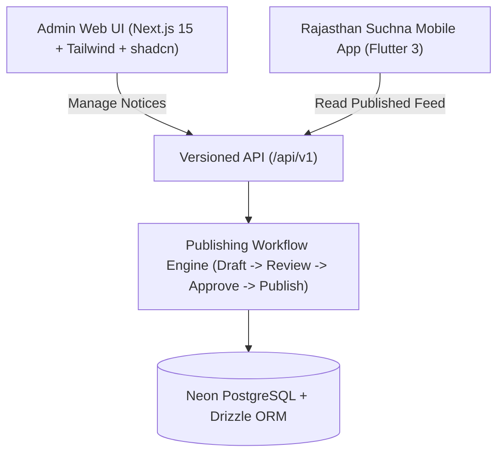

# 🏛️ Rajasthan Suchna Admin — System Architecture

Version 1.0 · Production Ready

## 1. High-Level Architecture

## 2. Core Security & Workflow Invariants
1. **Separation of Roles**:
   - `editor`: Can create and update draft notices.
   - `reviewer`: Can inspect evidence documents, verification dates, and approve.
   - `publisher`: Can push approved notices live to the public `/api/v1/notices` feed.
2. **Self-Approval Prohibition**:
   - An editor cannot approve their own notice. The state machine explicitly verifies `actorId !== editorId`.
3. **Immutable Snapshots**:
   - Every approved notice is snapshotted into `notice_revisions`. Any further edit generates a new draft revision while keeping the live published version undisturbed.
4. **Zero Downtime Local Fallback**:
   - The application features dual-mode operation: connects directly to Neon PostgreSQL when `DATABASE_URL` is supplied, and falls back to an in-memory repository store for rapid local development.
